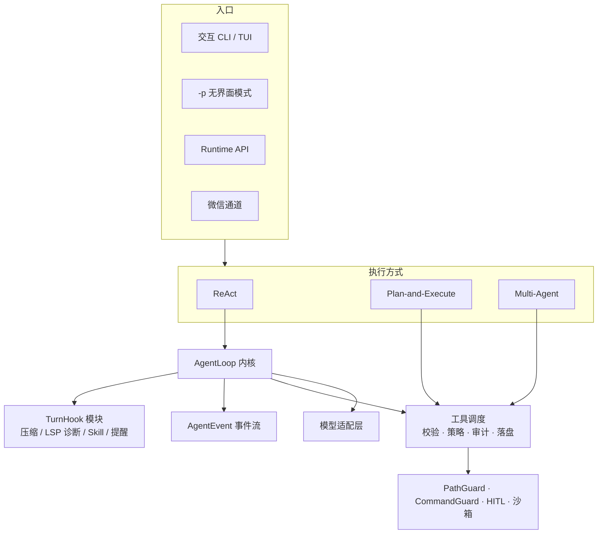

# Hao CLI

<p align="center">
  <strong>可嵌入的 Java Agent Runtime · 可验证的 Harness 实验平台 · 日常可用的 Coding CLI</strong>
</p>

<p align="center">
  <a href="https://github.com/SuperGh2233/AgentCli/actions/workflows/ci.yml"></a>
  
  
  
</p>

Hao CLI 是一个用 Java 写的 Agent 框架和终端编程助手。它把大模型外面那一层运行框架（Harness）做成独立的工程：Agent 循环、工具、权限、上下文管理、事件和对外接口，并用公开基准和消融实验检验每个机制到底有没有用。

项目不追求和 Claude Code、Codex 功能对齐，而是借鉴它们公开的设计思路：Pi 的最小内核、Claude Code 的上下文装配与分层压缩、Codex 的事件协议和权限隔离。

## 三个定位

| 定位 | 要证明什么 | 现状 |
| --- | --- | --- |
| **可嵌入的 Java Agent Runtime** | Java 应用不经过终端，直接接入模型、工具、上下文、权限和事件 | 统一的 `Tool` 接口、结构化工具状态和事件流已有；进程内 `HaoRuntime` SDK 还在开发 |
| **Harness 实验平台** | 上下文压缩等机制在固定模型、固定任务下的真实收益 | 已接入 Harbor + Terminal-Bench，五层压缩都有独立开关；**还没有正式成绩** |
| **日常 Coding CLI** | 真的能用来读代码、改代码、跑测试 | 可用：ReAct / Plan / Team 三种执行方式、MCP、记忆、代码检索 |

## 核心能力

| 模块 | 能力 |
| --- | --- |
| Agent 内核 | ReAct 循环 `AgentLoop`；压缩、诊断注入、Skill 注入、重复调用提醒都以 `TurnHook` 挂载，可单独关闭 |
| 执行方式 | ReAct、Plan-and-Execute（依赖 DAG、计划审阅、失败重规划）、Multi-Agent（Planner / Worker / Reviewer） |
| 工具 | 文件读写与编辑、代码搜索（ripgrep / 语义检索）、命令执行、联网搜索与抓取、Skill、MCP 工具 |
| 工具状态 | 成功 / 失败 / 拒绝 / 超时 / 取消 / 跳过 / 结果未知，由工具和调度层如实报告 |
| 上下文 | 分块装配 system prompt、外部内容单独标记为不可信、`HAO.md` 渐进加载、五层压缩、上下文超长时紧急压缩并重试 |
| 安全 | 路径限定在项目根目录、命令黑名单、人工确认（HITL）、权限规则、操作审计、可选 Seatbelt / bubblewrap 命令沙箱 |
| 无界面运行 | `-p` 一次执行，输出 text / JSON / JSONL 事件流；默认只读，有请求数、Token 和时间上限 |
| 外部接入 | MCP（stdio / Streamable HTTP，含 OAuth）、Runtime API、浏览器（Chrome DevTools MCP）、微信文本通道 |
| 模型 | DeepSeek、GLM、混元、StepFun、Kimi、讯飞星辰、Agnes 及 OpenAI 兼容网关，运行时切换 |

## 快速开始

需要 Java 17+ 和 Maven，以及至少一个模型 API Key（默认用 DeepSeek）。

```bash
git clone https://github.com/SuperGh2233/AgentCli.git && cd AgentCli
cp .env.example .env          # 填入 DEEPSEEK_API_KEY 等
mvn clean package             # 默认跳过测试
java -jar target/haocli-1.0-SNAPSHOT.jar
```

进入后直接输入任务即可；`/plan <任务>` 先规划再执行，`/team <任务>` 交给多 Agent 协作，`Shift+Tab` 切换模式。

### 无界面模式（脚本 / CI）

```bash
# 只读问答
java -jar target/haocli-1.0-SNAPSHOT.jar -p "总结这个项目的模块结构"

# 允许改文件，只放行一条命令，输出 JSONL 事件流
java -jar target/haocli-1.0-SNAPSHOT.jar -p "修复编译错误" \
  --permission-mode edit --allow-command "mvn -q compile" --output-format stream-json
```

退出码：0 完成、1 失败、2 参数错误、3 部分完成、130 取消。结果 JSON 里带工具统计、结束原因 `reason` 和各层压缩的触发次数，格式见 [无界面模式规格](docs/specs/headless-mode.md)。

## 常用命令

| 命令 | 作用 |
| --- | --- |
| `/plan [任务]` | 用 Plan-and-Execute 执行（`Enter` 执行、`I` 补充要求、`ESC` 取消） |
| `/team [任务]` | 用 Multi-Agent 协作执行 |
| `/mode auto\|plan\|ask` | 切换确认档位（也可 `Shift+Tab`） |
| `/context` | 查看上下文各部分占用的 Token |
| `/compact` | 手动压缩对话 |
| `/save`、`/memory` | 保存和管理长期记忆 |
| `/init` | 为当前项目生成 `HAO.md` 项目规则 |
| `/resume`、`--continue` | 恢复之前的会话 |
| `/mcp` | 管理 MCP server |
| `/permissions` | 查看和撤销已记住的权限规则 |

完整命令、配置项和环境变量见 [完整说明](docs/guide.md)。

## 架构



内核只负责“调模型 → 执行工具 → 写回对话”和取消、预算、事件；上下文压缩等机制都通过 `TurnHook` 接入，不写进循环。目前 Plan 和 Team 还各自维护执行循环，统一到 `AgentLoop` 是下一阶段的工作，详见 [路线图](docs/plans/active/PLAN-20261126-runtime-roadmap.md)。

## 评测

- **公开基准**：通过 [Harbor](https://github.com/harbor-framework/harbor) 跑 [Terminal-Bench](https://github.com/harbor-framework/terminal-bench)，适配器在 [`benchmarks/harbor/`](benchmarks/harbor/)。日常迭代用 2.0 的固定 30 题 × 3 次，最终对比用 4.1.0 全集。
- **消融开关**：`--harness-disable context`（或细分到 `context.offload/trim/fold/clearing/summary/runaway`、`lsp`），每次只改一个变量。
- **现状**：只有冒烟测试通过（1/1）。第一轮上下文策略消融因模型服务网络中断和余额不足作废，**目前没有可以对外引用的成绩**。所有轮次都记在 [评测台账](docs/evals/terminal-bench-ledger.md)，不挑结果、不重试。

## 安全边界

- 文件工具只能访问项目根目录之内；被安全策略拒绝的操作，用户确认也放不行。
- 写文件、执行命令、MCP 工具等危险操作按确认档位走人工确认，并写审计日志。
- 无界面模式、Runtime API、微信通道没有人确认：默认只读，命令必须逐条加入白名单。
- 命令沙箱默认关闭（`HAOCLI_COMMAND_SANDBOX=auto|required` 开启）。这些都是应用层保护，**不能替代系统权限、隔离环境和备份**，建议先在可丢弃的项目里试用。

## 开发

```bash
mvn test -Pquick                              # 日常回归（CI 同款）
mvn test -DskipTests=false -Dtest=XxxTest     # 单个测试（测试默认跳过）
mvn test -Pbenchmark                          # 评测包测试（有已知失败，按失败名单比对）
```

参与开发前先读 [AGENTS.md](AGENTS.md)（Codex、Claude Code、Hao CLI 共用的协作规则）。

## 文档

| 文档 | 内容 |
| --- | --- |
| [完整说明](docs/guide.md) | 配置、全部命令和工具、各期功能与演进历程 |
| [路线图](ROADMAP.md) · [当前主线计划](docs/plans/active/PLAN-20261126-runtime-roadmap.md) | 已完成和计划中的阶段 |
| [架构决定](docs/adr/) | 模块边界、结果语义、沙箱升级 |
| [评测计划](docs/plans/active/PLAN-20261127-terminal-bench-eval.md) · [台账](docs/evals/terminal-bench-ledger.md) | Terminal-Bench 做法、纪律和每轮结果 |
| [文档索引](docs/index.md) | 全部设计、规格和实施记录 |

## 致谢

Hao CLI 由 [SuperGh2233](https://github.com/SuperGh2233) 独立开发和维护。设计过程中参考了[沉默王二的 PaiCLI 项目与教程](https://javabetter.cn/sidebar/itwanger/paicli/)，仅作为思路参考与致谢，代码实现和后续演进由本项目独立维护，详见 [上游致谢](docs/UPSTREAM_ATTRIBUTION.md)。

## 许可证

仓库暂未包含许可证文件，使用前请联系作者确认授权范围。
