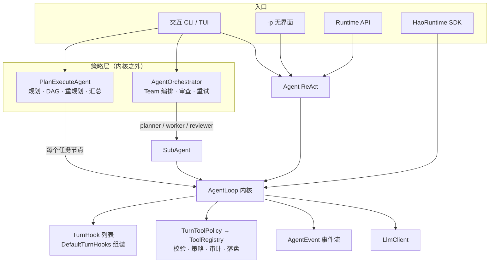

# HaoCli 运行时架构

> 2026-11-28 架构收敛后的现状。以代码为准；进度和下一步见 [HAO-ARCHITECTURE-ROADMAP](../plans/active/HAO-ARCHITECTURE-ROADMAP.md)。

## 1. 一句话

所有执行方式（ReAct、Plan 任务节点、Team 子 Agent、进程内 SDK）都跑在同一个最小内核 `AgentLoop` 上；上下文压缩、诊断注入、Skill 注入、提醒等能力以 `TurnHook` 模块挂上去，由组装方决定挂哪些；规划、DAG 调度、团队协作这些策略留在内核之外。



## 2. 模块职责边界

| 模块 | 负责 | 不负责 |
|---|---|---|
| `AgentLoop`（690 行） | 一轮“调模型 → 执行工具 → 写回对话”；取消和 Steering 安全点；预算检查和超预算收尾；截断的工具调用不执行；上下文超长时调模块紧急压缩后重试；发事件；返回 `COMPLETED / PARTIAL / FAILED / CANCELLED` 和机器可读原因 | 压缩算法、Skill 加载、项目记忆、LSP、长期记忆、规划、团队管理；也不 new 任何具体模块 |
| `TurnHook` | 四个挂点：请求前、工具结果追加前（可改写，不能改条数和顺序）、追加后、上下文超长 | 跳过内核的取消、预算、策略检查 |
| `DefaultTurnHooks` | 组装点：按 `HarnessFeatures` 生成默认模块列表（LSP 诊断 → 五层压缩 → 资源失败观察 → Skill 注入 → 重复调用提醒），可在前面加调用方自己的模块；每次运行新建实例 | 运行逻辑 |
| `ConversationContext` | 一个 Agent 自己的对话 + 会话记录；压缩后写检查点 | 跨 Agent 共享 |
| `PlanExecuteAgent` | 规划、计划审阅、DAG 依赖和并行批次、失败重规划、结果汇总；每个任务节点建独立对话交给内核 | 模型—工具循环（已删除） |
| `AgentOrchestrator` / `SubAgent` | Team 的规划、分派、审查和重试；每个子 Agent 一份独立对话，经内核执行，planner / reviewer 的轮次不带工具 | 模型—工具循环（已删除） |
| `HaoRuntime` | 进程内入口：显式注册模型、工具、上下文、权限、上限、事件；每次 `run` 是独立任务；`cancel()` | CLI、TUI、MCP、会话恢复 |
| `TurnToolPolicy` / `ToolRegistry` | 本轮工具策略、参数校验、PathGuard / CommandGuard、HITL / 白名单、审计、大结果落盘、并行只读调度 | 判断任务是否结束 |

## 3. Pi 最小内核思想的吸收情况

| 思想 | 现状 | 证据 |
|---|---|---|
| 内核只做循环协议 | 已做到：内核里没有压缩、Skill、记忆、LSP 的实现 | `AgentLoop.createHooks()` 只调用注入的 `Supplier<List<TurnHook>>` |
| 扩展通过组合接入 | 已做到：`DefaultTurnHooks` 组装，调用方可在前面加模块（Plan / Team 用它挂评测观察模块） | `DefaultTurnHooks.withLeading` |
| 扩展失败不拖垮内核 | 已做到：模块抛错只记日志跳过；改写工具结果时改了条数或顺序会被丢弃，配对不破坏 | `UnifiedKernelTest.injectedHooksRunInOrderAndAFailingOrMisbehavingHookCannotBreakPairing` |
| 所有执行方式一个循环 | 已做到：ReAct、Plan 任务节点、Team 子 Agent、SDK 都用 `AgentLoop`；Plan 和 SubAgent 的私有循环删除（SubAgent 823 → 718 行，PlanExecuteAgent 1416 → 1281 行） | `dc73943` |
| 扩展机制对外开放 | 已做到（SDK 范围）：嵌入方用公开的 `HaoRuntime.Hook`（请求前 / 工具结果后，只读对话视图、追加备注、发提示），内部适配成 `TurnHook`；内部的 `TurnHook` 本身不公开 | `HaoRuntimeExampleTest.embedderHooksSeeToolResultsAddNotesAndCannotBreakTheRun` |
| 依赖方向有测试守着 | 已做到：内核不准依赖界面、入口、MCP、评测和具体可选能力；SDK 不准依赖 CLI / TUI / MCP / 评测；产品代码不准依赖评测包 | `ArchitectureBoundaryTest` |

统一后 Plan 和 Team 新得到的保护：截断的工具调用不执行、上下文超长紧急压缩、取消检查、五层压缩全部生效并服从消融开关（以前只有清理 + 摘要两层，消融开关对它们无效）。

## 4. 进程内 SDK（HaoRuntime）

```java
HaoRuntime runtime = HaoRuntime.builder()
        .model(llmClient)                       // 任意 LlmClient
        .projectRoot(workspace)                 // 文件工具只能访问这里
        .tool(new OrderStatusTool())            // com.haocli.tool.Tool
        .context(task -> "订单号都是数字")        // 可信的嵌入方上下文
        .permissions(UnattendedPermissions.READ_ONLY)   // 默认只读
        .limits(new RunLimits(50, 2_000_000, Duration.ofMinutes(30)))
        .onEvent(event -> log(event))
        .build();
HaoRuntime.RunResult r = runtime.run("查一下订单 42");   // status / answer / reason / requests / tokens / ms
```

- 权限复用无人值守白名单（和 `-p`、Runtime API 同一套）：只读工具始终可用；写文件和有副作用的自定义工具只在 `edit` 下可用；命令要逐条列出；不支持 `sandbox`
- 验收示例 `src/test/java/com/haocli/sdk/example/HaoRuntimeExampleTest.java`：放在内核包之外，只用公开 API，假模型完成两步工具调用、上下文进系统提示词、事件和结构化结果、只读拒绝写文件、取消
- 自定义模块：`.hook(HaoRuntime.Hook)`，在内置模块之后按注册顺序调用，出错只记日志
- 还没有：多轮会话、流式回调之外的异步 API、独立 Maven 模块

## 5. 评测观察（审计）怎么保持不变

Plan 和 Team 的评测审计依赖执行过程中的观察事件。迁移到内核后：
- Plan：排在最前面的观察模块在 Skill 注入改写**之前**发 `ToolBatchReturned`，拿到的是原始工具结果；模型调用失败时重新抛出原始异常（`AgentLoop.Result.failure`），重规划和审计记录的异常类名不变
- Team：观察模块在压缩之前发 `CompactionScopeUnsupported`，摘要压缩事件、工具批次、预算收尾的迭代号和以前一致
- 证据：`PlanExecutionObservationTest`、`TeamExecutionObservationTest` 全过；`-Pbenchmark` 失败名单和 `38bdb3b` 逐条一致

## 6. 已知的有意行为变化

- Team 子 Agent 现在也做第 2 层历史裁剪，只保留最近 1 条带图片的消息（以前保留全部）
- 子 Agent 被取消时返回错误消息（以前没有取消检查，会继续跑）
