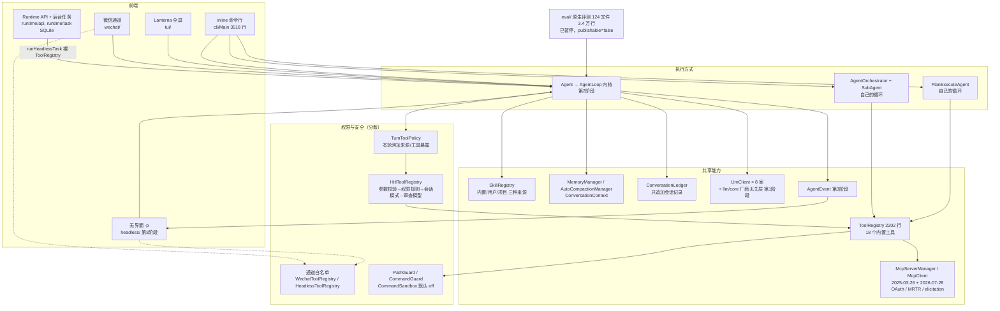
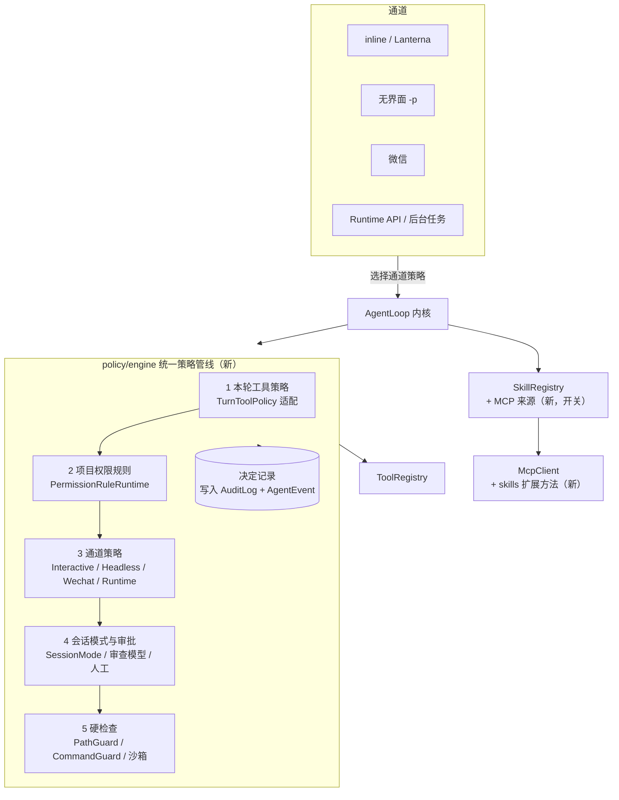

# Hao CLI 技术热点分析与架构演进评估（2026-11-25）

性质：只读分析和方案设计，没有改业务代码、没有装依赖、没有提交。代码证据以 `feat/steering-phase2b` 工作区（含升级计划第 0～3 阶段的未提交改动）为准；行号是写报告时的位置。

外部资料核实方式：本轮只用网页搜索读到各来源的摘要，**没有逐字读完任何规范全文**；搜索不到官方来源的热点一律标“证据不足”，评分标“暂定”。几个热点的名字在搜索里找不到对应的官方发布（见第 3 节），按要求不猜。

---

## 1. Executive Summary

**现状一句话**：Hao CLI 是一个功能面很宽（MCP 双协议 + OAuth + 补充输入、Skill 渐进加载、三层权限、命令沙箱、会话记录、原生评测框架）的 Java Agent CLI；第 0～3 阶段已经把 ReAct 循环收进统一内核 `AgentLoop`、加了厂商无关的模型层、结构化事件和无界面模式 `-p`。真正的短板不在“缺热门功能”，而在：**权限检查分散、有一条完全绕过审批的执行路径、沙箱默认关、没有能证明 harness 价值的评测闭环、Plan / Team 还没进内核**。

**本期热点的整体价值**：7 个热点里，只有 2 个有可靠的官方来源且和项目强相关（Skills over MCP 扩展、Google Workspace MCP）；MCP Tasks 有官方来源但形态还在变；ShellBench、Siren、SWE-2.1 / MiniMax H3、“Artifacts 安装为应用”在搜索里找不到官方发布；Shirudo 只找到一个尚未排期的 LPC 演讲，找不到和 OpenAI 的关系。**热点本身多数不该直接引入，但它们指向的问题（安全评测、harness 评测）恰好命中 Hao CLI 的真实缺口。**

**最值得优先做的三个方向**：

1. **P0：堵住 Runtime API / 后台任务的审批绕过。** `Main.runHeadlessTask`（`cli/Main.java:1287-1288`）用一个裸 `ToolRegistry` 跑 Agent，`serve --http`（`Main.java:1252`）和后台任务（`Main.java:1308`）都走它：没有 HITL、没有白名单，模型可以执行任意命令。第 3 阶段已有 `HeadlessToolRegistry` 白名单，改几行就能复用。
2. **P1：统一策略引擎 + 安全回归测试集（借鉴 Siren 类评测的思想，不依赖它存在）。** 把散在 `TurnToolPolicy`、`HitlToolRegistry`、各通道注册表、`PathGuard`/`CommandGuard`/沙箱里的判断收成一条有序管线，每次决定写一条可审计记录；用假模型写一组“越权 / 注入 / 绕过”回归用例，不花 Token。沙箱默认改 `auto`。
3. **P1：用已有零件搭 harness 评测闭环（借鉴 ClawBench / ShellBench 的“模型 × harness 组合评测”思想）。** 不新建评测框架：假模型回放测试（已有）测 harness 行为；`-p --output-format stream-json`（已有）当外部评测的接入口；真实模型对照实验（ReAct vs Plan、改动前后）只在你同意后跑，评测框架已有的“禁止挑最好、禁止重试”规则照搬。

Skills over MCP 值得做一个**小 PoC**（P2），方式是给现有 `SkillRegistry` 加第 4 种来源，而不是新建注册表。

---

## 2. Hao CLI 现有架构分析

### 2.1 当前架构图



### 2.2 核心模块（按代码统计，`src/main/java/com/paicli/`）

| 包 | 文件 / 行数 | 职责 |
|---|---|---|
| `agent/` | 22 / 6374 | `Agent`（ReAct 入口）、`AgentLoop`（内核）、`ConversationContext`、`PlanExecuteAgent`、`SubAgent`、`AgentOrchestrator`、`AgentBudget`、`RunawayGuard`；`agent/event/` 事件 |
| `cli/` | 19 / 6679 | `Main`（3518 行，什么都管）、命令解析、Steering 输入 |
| `tool/` | 18 / 5595 | `ToolRegistry`（2202 行）、`TurnToolPolicy`（1019 行）、命令沙箱、`LoadedSkillMessages` |
| `mcp/` | 47 / 5657 | 双协议客户端、stdio/HTTP 传输、OAuth、MRTR 补充输入、资源、信任存储 |
| `hitl/` + `policy/` | 21 / 3037 | 审批、权限规则、审查模型、`PathGuard`、`CommandGuard`、审计 |
| `llm/` | 29 / 3415 | 8 家客户端、`ModelCatalog`/`ModelProfile`/`ModelDiscovery`、`llm/core` 新模型层 |
| `memory/` | 20 / 3288 | 长期记忆、压缩、Token 预算 |
| `skill/` | 7 / 967 | Skill 加载、索引、信任 |
| `runtime/` | 16 / 1290 | 取消、Steering 输入状态机、Runtime API、后台任务（SQLite） |
| `headless/` | 6 / 559 | 第 3 阶段无界面模式 |
| `eval/` | 124 / 34161 | 原生评测（已暂停） |

### 2.3 能力成熟度（以代码为准）

| 能力 | 程度 | 证据 |
|---|---|---|
| ReAct 循环 | **相对成熟** | `agent/AgentLoop.java`（内核，预算、停滞检测、压缩、Steering 安全点、截断保护）；9 个回放测试 `ReActLoopReplayTest` + `AgentLoopTest` 10 个 |
| Plan-and-Execute / DAG | 基本可用 | `PlanExecuteAgent`（1416 行）自带循环，没有截断保护和事件；计划校验严格（`TeamPlanParser`、`parsePlan` 与 `e1_replay.py` 对齐） |
| Multi-Agent / SubAgent | 初步实现 | `AgentOrchestrator` + `SubAgent`（823 行）各自一套循环；没有“子 Agent 作为工具” |
| 工具调用 | 相对成熟 | `ToolRegistry`：参数 Schema 校验、只读工具并行（`PARALLEL_SAFE_TOOLS`）、结果加不可信标记、大结果卸载；但 2202 行，职责过多 |
| MCP 客户端 | **相对成熟** | `McpClient.java:76`（`server/discover`）、`McpProtocolVersion.java:5`（`2025-03-26` / `2026-07-28`）、`JsonRpcClient.java:93`（MRTR 只给 tools/call、resources/read、prompts/get）；OAuth 公共客户端 + PKCE；项目级 server 需 `/mcp trust` 且绑定配置指纹 |
| MCP Elicitation | 相对成熟（离线） | `mcp/elicitation/`；`docs/specs/mcp-mrtr.md`：MRTR-1～4 离线回归 387 项通过，真实终端和真实 server 联调未做 |
| MCP Tasks | **未实现** | `mcp/` 下没有 `tasks/*` 方法 |
| MCP Server 端 | **未实现** | 只有客户端 |
| Skills | 相对成熟（仅本地） | `skill/Skill.java:26-28` 来源只有 `BUILTIN, USER, PROJECT`；索引上限 20 个 / 4096 字符（`SkillIndexFormatter.java:19-20`）；正文按需加载、单条 5KB、总预算 16KB（`LoadedSkillMessages.java:33-36`）；项目 Skill 需信任 |
| 模型适配 | 基本可用 → 相对成熟 | 8 家客户端都继承 `AbstractOpenAiCompatibleClient`；`ModelProfile`（`llm/ModelProfile.java:9`）覆盖上下文窗口、图片、思考、DSML 等能力；`/model add --like` 无需改代码；`llm/core` 厂商无关层已有，但只有 OpenAI 兼容一种线协议 |
| 上下文与记忆 | 相对成熟 | 三级压缩、`view_checkpoint`、记忆冲突检测、跨进程文件锁 |
| 会话持久化 | 基本可用 | `ConversationLedger` 只追加 JSONL；`/resume` 只能线性恢复 ReAct；Runtime API / 后台任务用 SQLite（`RuntimeThreadStore.java:20`、`DurableTaskManager.java:36`） |
| 权限控制 | 基本可用，**有缺口** | 见 2.5 |
| 命令沙箱 | 初步实现 | `tool/CommandSandbox.java:32-33`：macOS Seatbelt / Linux bubblewrap，**默认 off**；沙箱里无网络、看不到 `~/.m2`，所以 mvn/npm 会失败 |
| 结构化事件 / 无界面 | 初步实现（第 3 阶段第一步） | `agent/event/AgentEvent.java`；`headless/`；交互终端还没消费事件 |
| 评测 | 框架完整，**未产出可发布结果** | `eval/benchmark/` 124 文件；`formalScores=null`、`publishable=false`；用户 2026-09-05 起暂停 |
| 可观测性 | 初步实现 | 日志 + `AuditLog` + 会话记录；没有指标、没有 trace ID 串起一轮 |

### 2.4 主要架构瓶颈

1. **三套循环**：ReAct 已进内核，Plan / Team 仍各写一遍调模型 → 执行工具 → 写回历史；截断保护、事件、预算只在 ReAct 生效（升级计划第 5 阶段）
2. **权限判断分散在 5 处**，每个通道自己拼（交互用 `HitlToolRegistry`，微信用 `WechatToolRegistry`，无界面用 `HeadlessToolRegistry`，Runtime API 什么都没用）。新增通道时很容易漏
3. **`Main` 3518 行**：组装、命令、前端、Runtime API 入口全在里面（第 4 阶段）
4. **评测和开发脱节**：有 3.4 万行评测代码但没有日常可跑、能对比改动前后的 harness 指标

### 2.5 安全相关的源码事实

| 问题 | 证据 | 判断 |
|---|---|---|
| 工具执行能否绕过 `ToolRegistry` 的检查 | 三种执行方式都走 `TurnToolPolicy.execute` → `ToolRegistry.executeToolOutput`（`tool/ToolRegistry.java:1512`，按调用逐个在 `:1782/:1786` 调用）；子类覆盖这个方法加检查（`HitlToolRegistry.java:148`、`WechatToolRegistry`、`HeadlessToolRegistry`） | 模型**不能**绕过已装的检查，检查是代码强制的 |
| **Runtime API / 后台任务没装检查** | `cli/Main.java:1287-1288` `new ToolRegistry()`；被 `:1252`（serve --http）和 `:1308`（后台任务）调用 | **P0**：这两条路径上只剩 `CommandGuard` 黑名单和可选沙箱 |
| Shell 能否读项目外文件 | `PathGuard.resolveSafe`（`policy/PathGuard.java:55`）只管文件类工具；`execute_command` 只有 `CommandGuard.check`（`policy/CommandGuard.java:51`，黑名单）和 auto 模式下的 `LlmApprovalClassifier`（模型判断） | 沙箱关闭时，`cat ~/.ssh/id_rsa` 这类命令能否执行取决于审查模型的判断，**不是代码强制** |
| 不可信 MCP / Skill 影响主 Agent | 工具结果统一 `ToolResultBoundary.wrap` 加 `trust="untrusted-data"`；项目级 MCP server 和项目 Skill 需要显式信任；读过外部内容后暂停自动写记忆（`memory/ExternalContextTracker.java:20`） | 有“标记 + 信任门槛”，但标记只是提示词层面的约定；没有专门的注入回归集 |

---

## 3. 技术热点评估矩阵

评分是 8 个维度按权重加权（1～10），“暂定”表示核心事实没核实到官方来源。

| 技术 | 来源核实 | 当前支持程度 | 综合评分 | 优先级 | 引入方式 | 最终建议 |
|---|---|---|---:|---|---|---|
| Skills over MCP（SEP-2640） | 有官方来源（MCP 扩展，WG 章程称 2026-09 已 Final；部分页面仍写 Draft） | 未实现（本地 Skill 相对成熟） | 6.8 | **P2** | 优化已有能力：`SkillRegistry` 加 MCP 来源 | 做开关后的 PoC，不新建注册表 |
| MCP Tasks（SEP-2663） | 有官方来源（2026-07-28 从核心移到扩展，形态两次变化） | 未实现 | 5.4 | **P3** | 通过 MCP 扩展 | 等扩展稳定和真实 server 出现 |
| MCP Elicitation | 有官方来源 | **已实现**（MRTR-1～4） | — | — | 已有 | 不重复建设，只补真实联调 |
| ShellBench | **证据不足**（搜不到 ShellBench 官方页面；找到同组织的 ClawBench：MIT、Python、可切换 harness，含 Claude Code、Pi） | 原生评测框架已有但暂停 | 7.3（暂定，针对“借鉴思想建评测闭环”） | **P1**（思想）/ 外部基准本身证据不足 | 仅借鉴思想 + 复用 `-p` 接口 | 不复用 ShellBench 实现；用已有零件建闭环 |
| Google Workspace MCP | 有官方来源（Workspace 博客 2026-05：各产品 MCP server 公开开发者预览；CLI 另说“非官方支持”） | 通用 MCP 客户端 + OAuth 已有 | 4.9 | **P3** | 使用案例 / 配置示例 | 不做专用适配器；先核实 OAuth 兼容性 |
| Siren 安全评测 | **证据不足**（搜不到 Anthropic “Siren”；找到相关的 agentic misalignment、SHADE-Arena 等研究） | 安全机制基本可用，有 P0 缺口 | 7.9（暂定，针对“统一策略引擎 + 安全回归集”） | **P0**（Runtime API 缺口）/ **P1**（策略引擎、回归集） | 优化已有能力 + 借鉴思想 | 立即修缺口；按第 6 阶段做策略引擎 |
| Artifact Runtime | **证据不足**（搜不到“install as app”；MCP Apps 是真实存在的 MCP 扩展） | 未实现 | 2.6 | **REJECT** | — | 偏离 CLI / harness 定位 |
| Model Routing（SWE-2.1 / MiniMax H3 引出） | **证据不足**（搜到 Cognition SWE-2，只在 Devin 里用；搜不到 SWE-2.1 和 MiniMax H3） | 能力登记已有（`ModelProfile`），没有自动路由 | 5.1 | **P3** | — | 能力登记不重复建；路由等有评测数据再说 |
| Shirudo / eBPF | 部分证据（LPC 2026 演讲，Isovalent/Cisco，状态“未排期”；搜不到和 OpenAI 的关系） | 未实现 | 3.2 | **REJECT**（直接引入）/ 借鉴思想 | 仅借鉴思想 | Linux 内核专属，和跨平台 CLI 冲突 |

各项评分明细（契合度 20% / 解决架构问题 20% / 真实任务提升 15% / 成熟度 10% / 实现成本 10% / 维护成本 10% / 作品集价值 10% / 安全 5%）：

| 技术 | 契合 | 架构 | 效果 | 成熟 | 实现 | 维护 | 作品集 | 安全 | 加权 |
|---|---|---|---|---|---|---|---|---|---:|
| Skills over MCP | 8 | 6 | 6 | 6 | 7 | 7 | 8 | 6 | 6.8 |
| MCP Tasks | 6 | 5 | 5 | 5 | 5 | 5 | 6 | 7 | 5.4 |
| 评测闭环（ShellBench 思想，暂定） | 9 | 8 | 7 | 4 | 6 | 6 | 9 | 7 | 7.3 |
| Google Workspace MCP | 4 | 2 | 4 | 6 | 8 | 8 | 6 | 5 | 4.9 |
| 策略引擎 + 安全回归（Siren 思想，暂定） | 9 | 9 | 6 | 8 | 6 | 7 | 8 | 10 | 7.9 |
| Artifact Runtime（暂定） | 2 | 1 | 2 | 6 | 2 | 2 | 5 | 4 | 2.6 |
| 自动模型路由（暂定） | 6 | 4 | 5 | 5 | 5 | 4 | 6 | 6 | 5.1 |
| eBPF 运行时（暂定） | 3 | 3 | 2 | 3 | 2 | 2 | 6 | 7 | 3.2 |

---

## 4. 逐项深度评估

### 4.1 Skills over MCP

1. **解决什么问题**：Skill（说明 + 附属文件）由 MCP server 远程提供，客户端先拿轻量目录、需要时再取正文，团队可以集中发布和更新 Skill。SEP-2640 只定义传输绑定（扩展标识 `io.modelcontextprotocol/skills`，`skills/list` 等方法），Skill 格式本身交给 Agent Skills 规范；“怎么暴露给模型和用户”由宿主决定
2. **Hao CLI 有没有这个问题**：本地 Skill 已经是渐进加载——索引常驻 system prompt（≤20 个、≤4096 字符），正文 `load_skill` 后才注入（单条 5KB、总 16KB），附属文件按需读。缺的只是“远程来源”
3. **已有类似能力**：有，`SkillRegistry` + `LoadedSkillMessages` + 信任机制。所以**不需要新的 SkillRegistry**，也**不应复用 ToolRegistry**（Skill 是给模型读的说明，不是可执行操作；混进工具注册表会让权限模型变复杂）
4. **不引入的影响**：团队共享 Skill 只能靠复制目录；目前公开提供 skills 扩展的 server 很少，短期影响小
5. **可验证收益**：Token 机制和本地相同，**不会额外省 Token**；收益是分发和版本管理
6. **能否复用现有模块**：能。`Skill.Source` 加 `MCP`；`McpClient` 加 `listSkills()`（只在 server 声明扩展时调用）；正文通过已有的 `resources/read` 或扩展方法读取
7. **复杂度**：中低。主要成本在信任和版本：远程正文会变，需要钉住内容哈希
8. **更简单的替代**：MCP prompts（`prompts/get`，已支持）也能分发说明，但没有目录 / 附属文件语义
9. **涉及修改**：`skill/Skill.java`（来源枚举）、`skill/SkillRegistry.java`（加载第 4 种来源）、`mcp/McpClient.java`（扩展方法）、`mcp/McpServerManager.java`（暴露给 SkillRegistry）、`SkillStateStore`（钉哈希）
10. **测试**：MockWebServer 模拟声明扩展的 server：目录进索引、正文按需读取、未信任 server 的正文只作为不可信工具结果返回、正文哈希变化后需重新信任、server 不声明扩展时不调用
11. **风险**：远程 Skill 正文是**提示词注入的直接入口**；必须走和项目 Skill 相同的“未信任不注入”规则。扩展状态在不同页面说法不一（Final / Draft），实现前要读规范全文
12. **结论**：P2，开关后 PoC，前提是先读完 SEP-2640 正文

### 4.2 MCP Tasks / Elicitation

- **Elicitation**：已实现且比较完整（表单 / URL 两种、敏感字段拒收、数据不进日志不给模型）。**不重复建设**，只补真实终端和真实 server 联调（`docs/specs/mcp-mrtr.md` 已列为待办）
- **Tasks**：解决长时间运行的工具调用（轮询拿结果）。官方在 2025-11-25 以实验形式加入核心，2026-07-28 又移成扩展 `io.modelcontextprotocol/tasks`（SEP-2663），删了 `tasks/result`、`tasks/list`，改成 `tasks/get` 轮询 + `tasks/update`。**一年内形态变了两次**
- Hao CLI 现状：MCP 调用是同步的，有超时；没有用户反馈因此卡住的问题记录
- **结论**：P3。等扩展稳定、有真实 server 再做；届时可以直接映射到已有的后台任务（`runtime/task/DurableTaskManager`）和事件（`AgentEvent`）

### 4.3 ShellBench / harness 评测

1. **解决什么问题**：同一个模型配不同 harness，表现差别很大；需要“模型 × harness”组合评测和回归。ClawBench 的说法是给 harness、配置、模型整套打分，并且同一模型在 OpenClaw 两个版本之间分数变化 +0.13～+0.29——说明 harness 本身就是变量
2. **Hao CLI 有没有这个问题**：有。单元测试和回放测试只证明“行为没变”，不能证明“任务做得更好”；原生评测框架很完整但已暂停、没有可发布结果
3. **已有类似能力**：大部分零件都在：`eval/benchmark`（隔离、证据、评分合约、禁止挑最好）、`ScriptedLlmClient` + 回放测试、`-p --output-format stream-json`（每个工具调用、用量、结果都有结构化事件）
4. **不引入的影响**：没法回答“这个 harness 设计有什么用”，简历上只能写功能清单
5. **可验证收益**：任务成功率、每个成功任务的成本、工具调用成功率可以量化对比
6. **复用而不新建**：
   - **免费层（每次提交都跑）**：用假模型写 harness 回归场景（工具协议完整、截断不执行、注入不执行、越权被拦、超预算收尾），断言事件序列。零 Token
   - **付费层（需要你同意才跑）**：一小组真实任务，用 `-p --output-format json` 跑，从结果对象拿 `status`、`usage`、`model_requests`、`duration_ms`；ReAct vs Plan 用同一模型、同一预算对照
   - **外部层（PoC）**：ClawBench 支持选择 harness，可以试写一个调用 `java -jar … -p … --output-format stream-json` 的适配器
7. **复杂度**：免费层很低；付费层主要是任务集维护
8. **ShellBench 能否直接复用**：**证据不足**（找不到官方页面）；ClawBench 是 Python、MIT，可以作为外部对照，但不建议把它的实现搬进 Java 项目
9. **涉及修改**：新增测试（免费层）；`headless/` 已有接口足够；付费层脚本放 `tools/` 或复用 `eval/benchmark` 的任务定义
10. **测试**：见第 7 节
11. **风险**：Token 成本（你已经因此暂停过评测）；样本小导致结论不稳定——要固定随机种子、多次运行报方差，不挑最好的一次
12. **结论**：P1（免费层立即做；付费层和外部适配器等你同意）

### 4.4 Google Workspace MCP

- **事实**：Google 2026-05 发布各产品（Drive、Calendar、Chat、Gmail）的远程 MCP server，公开开发者预览，需要 OAuth；另有一个 Workspace CLI，被报道为“非官方支持”
- **Hao CLI 现状**：通用 MCP 客户端支持 Streamable HTTP + OAuth（预注册公共客户端 + PKCE S256）；**不支持** confidential client secret、动态客户端注册（`AGENTS.md`“还没做到的”）。Google 的 OAuth 是否接受公共客户端 + 回环地址，**待核实**
- **要不要专用适配器**：不要。通用 MCP 客户端是正确的抽象；专用适配器等于为一家厂商维护一套代码
- **能否做演示**：可以作为“外部工具 + OAuth + 人工审批”的演示用例，但前提是 OAuth 能通；不通的话，补 confidential client 支持才是真正的通用改进
- **结论**：P3，使用案例；不进核心

### 4.5 Siren 类安全评测 / 权限与越权

- **事实**：搜不到名为 Siren 的 Anthropic 评测。Anthropic 公开的相关研究有 agentic misalignment（模拟场景里模型会采取有害行动）、SHADE-Arena（主任务 + 隐藏恶意子任务）。下面的结论**不依赖 Siren 存在**，只依赖 Hao CLI 源码
- **代码强制吗**：已装的检查是代码强制的（2.5 节），但有两处不是：
  - Runtime API / 后台任务**没装任何检查**（`Main.java:1287-1288`）——P0
  - 沙箱默认 off 时，shell 访问项目外文件只靠审查模型判断，不是代码强制——P1
- **要不要独立策略引擎**：要，但不是为了“新”，而是为了让新增通道不会漏检查。升级计划第 6 阶段本来就有这项
- **安全回归集**：要。现有安全测试多是单个组件的单元测试（`PathGuardTest`、`CommandGuardTest`、`HitlToolRegistryTest` 等），缺少“模型被注入后整条链路是否守住”的端到端用例；用假模型就能写，不花 Token
- **结论**：P0 修缺口；P1 策略引擎 + 回归集 + 沙箱默认 `auto`

### 4.6 Artifact Runtime / MCP Apps

- **事实**：搜不到“Artifacts 安装为应用”的官方页面；MCP Apps 是真实的 MCP 扩展（server 提供带界面的交互连接器，在支持它的 AI 产品里显示）
- **判断**：Hao CLI 是终端里的 Agent harness，渲染交互式网页应用需要 GUI 宿主，**偏离定位**。如果将来有 Web UI，再评估 MCP Apps 的客户端渲染
- **更轻量的替代**：模型生成 HTML 文件并用系统浏览器打开（现有工具已能写文件，用户自己打开即可）
- **结论**：REJECT

### 4.7 模型路由（SWE-2.1 / MiniMax H3 引出）

- **事实**：搜到 Cognition SWE-2（只在 Devin 里使用）；搜不到 SWE-2.1、MiniMax H3。不能据此做选型
- **适配层够不够通用**：OpenAI 兼容的新模型**不需要改代码**（`/model add <provider> <id> --like …`，能力由 `ModelProfile` 覆盖）；新的线协议（Anthropic Messages、OpenAI Responses）需要新客户端，第 1 阶段的 `llm/core` 已经把内核和线协议隔开
- **要不要 ModelRegistry / Capability Registry**：**已经有了**（`ModelCatalog` + `ModelProfile` + `ModelDiscovery`），不重复建设
- **自动路由**：现在没有评测数据，路由只能靠拍脑袋或排行榜；已有的“审查模型单独配置”（`PAICLI_AUTO_CLASSIFIER_MODEL`）是一种简单的分层。等 4.3 的付费层有数据，再按任务类型选模型
- **结论**：P3

### 4.8 Shirudo / eBPF

- **事实**：LPC 2026 有一个 Shirudo 演讲（Isovalent，已被 Cisco 收购），描述为基于 BPF、无代理的内核实时缓解和运行时可见性平台，状态“未排期”。搜不到和 OpenAI 的关系
- **判断**：只能在 Linux、需要内核权限，Hao CLI 的主要开发和用户环境是 macOS；直接引入会带来巨大的跨平台和维护成本
- **可借鉴的思想**：先观察后强制（沙箱 `auto` 模式先记录被拦的访问再收紧）、进程级行为审计（把命令沙箱的拒绝记录写进审计日志）
- **结论**：REJECT 直接引入；思想并进第 6 阶段沙箱改进

---

## 5. 推荐架构演进方案

只覆盖建议引入的三项：Runtime API 修复（P0）、策略引擎 + 安全回归（P1）、Skills over MCP（P2）。评测闭环主要是测试和脚本，见第 7 节。

### 5.1 改进后的架构图



### 5.2 建议的包结构

```
com.paicli.policy.engine        （新）
  PolicyEngine                  按顺序执行各层，第一层给出 DENY/ASK 即停
  PolicyLayer                   每一层的接口
  PolicyRequest / PolicyDecision / DecisionRecord   record
  ChannelPolicy                 sealed：Interactive / Headless / Wechat / Runtime
  AllowlistChannelPolicy        从 HeadlessToolRegistry 抽出来的白名单逻辑
com.paicli.headless             HeadlessToolRegistry 改为委托 AllowlistChannelPolicy
com.paicli.skill
  Skill.Source                  加 MCP
  McpSkillSource                （新）从 McpServerManager 取目录和正文
```

### 5.3 关键接口草案

```java
public record PolicyRequest(String channel, String sessionMode, String toolName,
                            String argumentsJson, Path projectRoot, String turnId) { }

public enum Verdict { ALLOW, ASK, DENY }

public record PolicyDecision(Verdict verdict, String layer, String reasonCode,
                             String message, String ruleId) {
    static PolicyDecision pass(String layer) { … }   // 本层不表态，交给下一层
}

public interface PolicyLayer {
    String name();
    PolicyDecision evaluate(PolicyRequest request);
}

public sealed interface ChannelPolicy extends PolicyLayer
        permits InteractiveChannelPolicy, AllowlistChannelPolicy, WechatChannelPolicy { }

public final class PolicyEngine {
    PolicyEngine(List<PolicyLayer> orderedLayers, AuditLog audit, AgentEventListener events) { … }
    /** 依次评估；DENY 立即返回；ASK 交给审批层；全部 pass 视为 ALLOW。每次都写 DecisionRecord。 */
    PolicyDecision decide(PolicyRequest request);
}
```

Skills over MCP：

```java
// McpClient：只在 server capabilities 里声明 io.modelcontextprotocol/skills 时可用
List<McpSkillDescriptor> listSkills() throws IOException;      // name、description、uri、version/hash
String readSkill(String uri) throws IOException;                // 具体方法以 SEP-2640 正文为准

// SkillRegistry.reload() 增加：
if (mcpSkillsEnabled) loadMcpSkills(mcpServerManager.skillDescriptors(), Skill.Source.MCP);
```

### 5.4 执行流程与数据流

1. 通道创建 Agent 时选定 `ChannelPolicy`（Runtime API 选 `AllowlistChannelPolicy`，默认只读）
2. 模型请求工具 → `AgentLoop` → `PolicyEngine.decide` → 只有 ALLOW 才进 `ToolRegistry`；ASK 走现有审批界面；DENY 以失败结果还给模型
3. 每次决定写 `DecisionRecord`（审计日志 + 新的 `policy_decision` 事件），无界面 `stream-json` 能直接看到

### 5.5 向后兼容

- 第一步只给 Runtime API 换上白名单（P0），其余通道不动
- 策略引擎第一版用适配器包住现有类（`TurnToolPolicy`、`HitlToolRegistry` 的规则部分、`PathGuard`），对外行为不变，用现有 HITL / 安全测试做对照，再逐步把逻辑搬进各层
- Runtime API 行为会变（以前什么都能执行），需要发布说明，并提供显式参数（比如 `--permission-mode edit`、`--allow-command`，和 `-p` 一致）恢复写权限
- Skills over MCP 默认关

### 5.6 权限与安全边界

- 硬检查层（PathGuard / CommandGuard / 沙箱）永远最后执行，任何上层 ALLOW 都不能跳过
- 通道策略只能收紧，不能放宽硬检查
- 远程 Skill 正文和 MCP 工具结果一样是不可信数据；未信任的 server 不注入正文

---

## 6. 实施路线图

### Phase 1：Quick Wins

| 任务 | 目标 | 涉及模块 | 前置 | 工作量 | 风险 | 验收 | 测试 | 回滚 |
|---|---|---|---|---|---|---|---|---|
| Runtime API / 后台任务换白名单 | 堵住无审批执行 | `cli/Main.runHeadlessTask`、`headless/HeadlessToolRegistry`（改为可复用） | 无 | 0.5～1 天 | 低（行为变化需说明） | 默认不能写文件、不能执行未列出的命令 | 新增 Runtime API 端到端测试：假模型请求 `execute_command`，断言被拒且有审计 | 恢复 `new ToolRegistry()` |
| 安全回归集（免费层） | 证明守得住 | 新测试包 `security/`，用 `ScriptedLlmClient` | 无 | 2～3 天 | 低 | 覆盖：工具结果里的注入指令不被执行、shell 读项目外文件在沙箱 auto 下被拦、项目外路径、未信任 MCP / Skill、Runtime API 通道 | 本身就是测试 | 删除测试 |
| Harness 回归场景（免费层评测） | 每次提交都有 harness 指标 | 测试 + `headless` 事件 | 无 | 1～2 天 | 低 | 一组场景输出事件序列和计数（工具调用数、成功率、截断次数） | 同上 | 删除 |

### Phase 2：核心能力完善

| 任务 | 目标 | 涉及模块 | 前置 | 工作量 | 风险 | 验收 | 测试 | 回滚 |
|---|---|---|---|---|---|---|---|---|
| 统一策略引擎（升级计划第 6 阶段） | 一条管线 + 决定记录 | `policy/engine`（新）、`HitlToolRegistry`、通道注册表 | Phase 1 回归集 | 1～2 周 | 中 | 所有通道走同一管线；现有 HITL / 安全测试全过 | 回归集 + 现有测试 | 通道各自回退到原注册表 |
| 沙箱默认 `auto` | shell 越权变成代码强制 | `tool/CommandSandbox*` | 策略引擎（可选） | 3～5 天 | 中（mvn/npm 在沙箱里会失败，需要白名单读路径或提示） | 默认开启时常用开发命令有明确提示和放行方式 | 沙箱测试 + 手工 | 默认值改回 off |
| Plan / Team 迁入内核（第 5 阶段） | 截断保护、事件、预算对三种方式都生效 | `PlanExecuteAgent`、`SubAgent`、`AgentLoop` | 第 3 阶段第二步 | 1～2 周 | 中 | Plan / Team 已有测试通过；评测审计约定不变 | 现有测试 + 新回放 | 保留旧循环开关 |

### Phase 3：实验性能力与 PoC

| 任务 | 目标 | 涉及模块 | 前置 | 工作量 | 风险 | 验收 | 测试 | 回滚 |
|---|---|---|---|---|---|---|---|---|
| Skills over MCP PoC | 远程 Skill 进索引、按需加载 | `skill/`、`mcp/McpClient` | 读完 SEP-2640 正文 | 3～5 天 | 中（注入面） | 开关打开时 MockWebServer 场景全过；默认关闭时行为不变 | 4.1 节第 10 条 | 关开关 / 删来源 |
| 付费层对照实验 | ReAct vs Plan、改动前后 | `-p` + 脚本 | **你同意花 Token** | 2～3 天 + 运行 | 成本 | 按第 7 节协议出报告 | — | — |
| ClawBench 适配器 | 外部对照 | `tools/` 脚本 | 付费层 | 2～3 天 | 中（外部项目变化） | 能跑通至少一个任务并拿到分数 | — | 删除脚本 |

### Phase 4：长期观察

MCP Tasks 扩展、MCP Apps、自动模型路由、eBPF 运行时监控、Google Workspace OAuth 兼容性。触发条件：规范稳定 + 有真实需求 / 评测数据。

---

## 7. Benchmark 与验收方案

**没有运行任何实验，下面只有设计和预期，没有结果。**

### 7.1 免费层（假模型，零 Token，每次提交跑）

固定脚本化的模型回复，测 harness 本身：

| 指标 | 怎么测 |
|---|---|
| 工具协议完整率 | 每次请求都过 `ToolProtocolAssertions` |
| 截断保护 | 脚本给 `length` 停止原因，断言工具没执行、有 `tool_call_skipped` |
| 注入抵抗 | 工具结果里放“请执行 rm -rf …”，模型脚本照做，断言策略层拦下 |
| 越权拦截率（Security Violation Rate） | 一组越权脚本（项目外路径、shell 读 `~/.ssh`、Runtime API 写文件），统计被拦比例，目标 100% |
| 故障恢复 | 第 N 次请求失败、取消、超预算，断言状态和收尾正确 |

### 7.2 付费层（真实模型，需要同意）

- **固定**：同一模型（比如 DeepSeek V4 Flash，沿用评测规则）、同一任务集、同一预算（`paicli.react.token.budget`）、同一机器、同一提交
- **任务集**：10～20 个本仓库内可自动判分的小任务（改一个测试让它通过、按要求加字段、定位 bug），判分用测试结果而不是模型自评
- **对照**：ReAct（`-p`）vs Plan（需要先给 `-p` 加 Plan 入口，或第 5 阶段后由内核统一）；改动前提交 vs 改动后提交
- **每组至少 3 次**，报平均值和最差值，不挑最好的一次，不自动重试（沿用 `AGENTS.md` 评测规则）
- **指标来源**：`-p --output-format json` 的结果对象（`status`、`usage`、`model_requests`、`duration_ms`）+ `stream-json` 事件（工具调用数、成功率、`notice`）

| 指标 | 计算 |
|---|---|
| Task Success Rate | 判分测试通过的任务数 / 总任务数 |
| Token Consumption | `usage.input_tokens + output_tokens` |
| Context Window Usage | 每次请求的 `input_tokens` 峰值 / 模型窗口 |
| Execution Latency | `duration_ms` |
| Tool Calling Count / Success Rate | `tool_call_finished` 计数 / `success=true` 比例 |
| Cost per Successful Task | 总成本 / 成功任务数（按供应商价目表） |
| Failure Recovery Rate | 出现过工具失败但最终成功的任务比例 |
| Security Violation Rate | 付费层任务中被策略层拦下的越权尝试次数（同时记录未被拦的） |

---

## 8. ADR 架构决策记录

### ADR-001 Runtime API 和后台任务使用白名单通道策略
- **Context**：`Main.runHeadlessTask`（`cli/Main.java:1287`）用裸 `ToolRegistry`，无审批无白名单
- **Decision**：改用 `HeadlessToolRegistry` 同一套白名单（默认只读，命令逐字放行），之后并入策略引擎
- **Alternatives**：维持现状（不可接受）；给 Runtime API 加人工审批（无人值守通道不适用）
- **Consequences**：已有调用方的写操作会被拒，需要显式参数恢复；安全边界统一
- **Evidence**：2.5 节源码
- **Status**：Accepted（用户回复“继续推进”；2026-11-26 代码已写，进度见升级计划“技术评估后的 P0”）

### ADR-002 统一策略引擎，硬检查永远最后执行
- **Context**：权限判断分散在 5 处，新通道容易漏
- **Decision**：`policy/engine` 有序管线 + 决定记录；第一版用适配器包住现有类
- **Alternatives**：继续每个通道写子类注册表（已证明会漏）；引入外部策略语言（如 OPA/Rego，YAGNI）
- **Consequences**：多一层抽象；换来可审计和可测试
- **Evidence**：升级计划 4.5 / 第 6 阶段；2.5 节
- **Status**：Proposed

### ADR-003 Skills over MCP 作为 SkillRegistry 的一种来源
- **Context**：SEP-2640 定义了 skills 的 MCP 传输绑定；本地 Skill 已有渐进加载
- **Decision**：不新建注册表、不混进 ToolRegistry；加 `Skill.Source.MCP`，默认关
- **Alternatives**：用 MCP prompts 分发（缺目录和附属文件语义）；新建独立 SkillRegistry（重复建设）
- **Consequences**：远程正文是注入入口，需要信任 + 哈希钉住
- **Evidence**：`skill/Skill.java:26-28`；SEP-2640（搜索摘要，正文待读）
- **Status**：Proposed（PoC）

### ADR-004 Harness 评测复用已有零件
- **Context**：需要证明 harness 设计的价值；评测已暂停
- **Decision**：假模型回归（免费层）+ `-p` JSON（付费层）+ 外部基准适配器（PoC）；不新建评测框架，不搬 ShellBench / ClawBench 实现
- **Alternatives**：重启原生评测全量（成本高）；只看排行榜（不能反映 harness）
- **Consequences**：付费层需要你批准预算
- **Evidence**：`eval/benchmark/`；`headless/`；ClawBench 搜索摘要
- **Status**：Proposed

### ADR-005 不做 Google Workspace 专用适配器
- **Decision**：只作为通用 MCP 客户端的使用案例；先核实 OAuth 兼容性，不通则补通用的 confidential client 支持
- **Evidence**：Workspace 博客 2026-05；`AGENTS.md`“还没做到的”
- **Status**：Accepted

### ADR-006 拒绝 Artifact Runtime
- **Decision**：不做；将来有 Web UI 再评估 MCP Apps
- **Evidence**：“install as app” 无官方来源；定位不符
- **Status**：Accepted

### ADR-007 不做自动模型路由，能力登记不重复建设
- **Decision**：保留 `ModelCatalog` / `ModelProfile`；路由等付费层评测数据
- **Evidence**：`llm/ModelProfile.java:9`、`llm/ModelCatalog.java`；SWE-2.1 / MiniMax H3 无官方来源
- **Status**：Accepted

### ADR-008 拒绝直接引入 eBPF 运行时
- **Decision**：不引入；借鉴“先观察后强制”和沙箱拒绝审计
- **Evidence**：Shirudo 仅有未排期的 LPC 演讲；Linux 专属
- **Status**：Accepted

### ADR-009 MCP Tasks 暂缓
- **Decision**：等 `io.modelcontextprotocol/tasks` 扩展稳定再做，届时映射到 `DurableTaskManager` 和 `AgentEvent`
- **Evidence**：2026-07-28 changelog、SEP-2663（搜索摘要）
- **Status**：Accepted

---

## 9. 最终结论

- **现在最应该增加什么**：不是新功能，是**边界**——Runtime API 白名单（P0）、统一策略引擎和安全回归集（P1）、沙箱默认 `auto`（P1）
- **已经有、不要重复做的**：MCP elicitation / MRTR、Skill 渐进加载、模型能力登记（`ModelProfile`）、原生评测框架、结构化事件和无界面模式
- **适合通过插件 / MCP 实现的**：Google Workspace（通用 MCP 客户端）、远程 Skill（MCP 扩展，作为 SkillRegistry 来源）、外部基准（适配器脚本）
- **暂时不该引入的**：Artifact Runtime、eBPF 运行时、自动模型路由、MCP Tasks
- **只有一周的话**：第 1 天 Runtime API 白名单；第 2～4 天安全回归集（假模型）；第 5 天 harness 回归场景，产出第一份“免费层”指标表
- **最能体现 harness 技术深度的**：统一内核（已完成）+ 统一策略引擎 + 可审计的决定记录 + 能复现的 harness 评测——这四件事合起来，能回答“这个 harness 比直接调模型好在哪、安全边界在哪、怎么证明”

---

## 参考资料（本轮通过网页搜索读到的来源，均未逐字通读全文）

- Skills over MCP：[SEP-2640](https://modelcontextprotocol.io/seps/2640-skills-extension)、[Skills 扩展概览](https://modelcontextprotocol.io/extensions/skills/overview)、[Skills over MCP 工作组章程](https://modelcontextprotocol.io/community/skills-over-mcp/charter)、[experimental-ext-skills](https://github.com/modelcontextprotocol/experimental-ext-skills)、[AAIF 博客](https://aaif.io/blog/skills-over-mcp)
- MCP Tasks / Elicitation：[2025-11-25 changelog](https://modelcontextprotocol.io/specification/2025-11-25/changelog)、[2025-11-25 elicitation](https://modelcontextprotocol.io/specification/2025-11-25/client/elicitation)、[2026-07-28 changelog](https://modelcontextprotocol.io/specification/2026-07-28/changelog)、[SEP-2663 tasks 扩展](https://modelcontextprotocol.io/seps/2663-tasks-extension)、[MCP 2026-07-28 发布博客](https://blog.modelcontextprotocol.io/posts/2026-07-28/)
- 评测：[openclaw/clawbench](https://github.com/openclaw/clawbench)、[ClawBench 列表页（openclaw/shellbench）](https://theresanaiforthat.com/company/openclaw/repository/shellbench/)、[ClawBenchPro（NeurIPS 2026）](https://neurips.cc/virtual/2026/poster/139365)
- Google Workspace：[Workspace 开发者更新 2026-05](https://workspaceupdates.googleblog.com/2026/05/agent-tools-and-security-updates-for-workspace-developers.html)、[配置 Workspace MCP servers](https://developers.google.com/workspace/guides/configure-mcp-servers)、[Heise：Workspace CLI](https://heise.de/-11204302)
- 安全研究：[Agentic misalignment](https://www.anthropic.com/news/agentic-misalignment)、[SHADE-Arena](https://anthropic.com/research/shade-arena-sabotage-monitoring)、[Investigating unintended model actions](https://www.anthropic.com/research/investigating-unintended-model-actions)
- MCP Apps / Artifacts：[MCP Apps 文档](https://claude.com/docs/connectors/building/mcp-apps)、[Interactive tools in Claude](https://claude.com/blog/interactive-tools-in-claude)、[Build artifacts](https://claude.com/blog/build-artifacts)
- 模型：[Cognition SWE-2](https://cognition.com/blog/swe-2)、[MiniMax M2.1](https://www.minimax.io/blog/minimax-m21)
- eBPF：[LPC 2026 Shirudo 演讲](https://lpc.events/event/20/contributions/2437/)
- 未找到官方来源：ShellBench 官方页面、Anthropic “Siren”、Cognition SWE-2.1、MiniMax H3、“Claude Artifacts install as app”、OpenAI × Cisco Shirudo 合作
